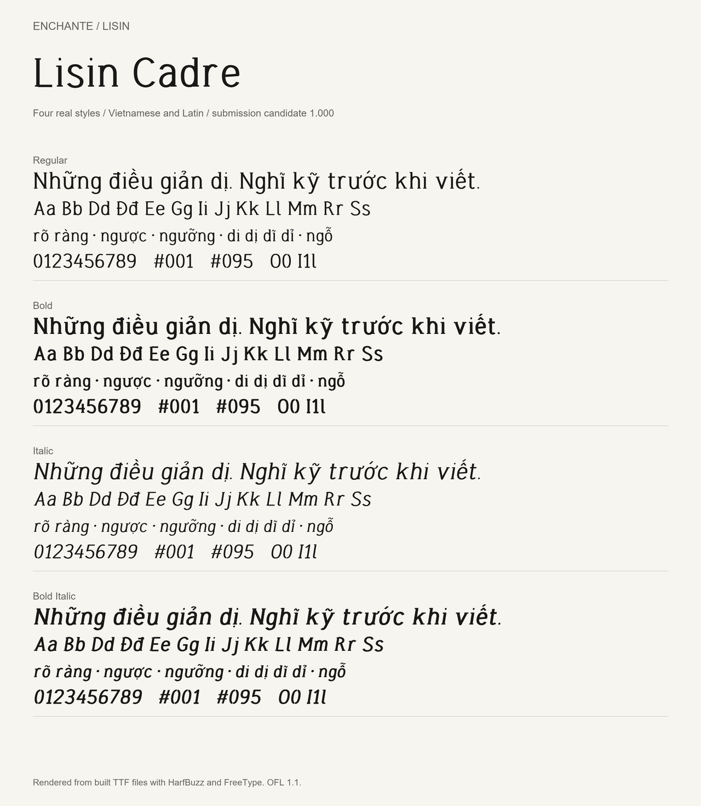

# Lisin

Lisin is a collection of three proportional Latin type families developed by
**Enchante**, with particular attention to Vietnamese text.

| Family | Intended use | Styles |
| --- | --- | --- |
| Lisin Studio | Branding, communication and expressive headings | Regular, Bold, Italic, Bold Italic |
| Lisin Logic | Interfaces, information and forms | Regular, Bold, Italic, Bold Italic |
| Lisin Cadre | Documents, reports and administrative text | Regular, Bold, Italic, Bold Italic |

These are proportional fonts, not monospaced coding fonts. The `tnum` feature
provides tabular digits. The family names above are the intended application-menu names.



[Studio specimen](documentation/studio-specimen.png) ·
[Logic specimen](documentation/logic-specimen.png)

## Status

Version 1.000 is a Google Fonts submission candidate. It is not an accepted
Google Fonts release. See [QA status](documentation/QA.md) for actual results
and outstanding review items. The existing deployed application fonts have
not been replaced by this candidate.

## Source and build

The `sources/` directory contains twelve editable UFO sources, including
quadratic outlines, Unicode mappings, metrics and OpenType feature code.
The sources were imported from approved Lisin pre-release fonts; their
identities are recorded in [the source manifest](documentation/approved-source-manifest.json).

With Python 3.12:

```sh
python -m venv .venv
# Activate .venv using your operating system's normal command.
python -m pip install -r requirements.txt
python sources/build.py
python sources/check.py
```

The build writes four TTF files per family to `fonts/ttf/<family>/`.
To build one family, use `python sources/build.py --family cadre`.

## Provenance and license

Lisin is an **OFL derivative of Instrument Serif**, not a claim that every
outline was originally drawn by Enchante. Basic Latin letters, numerals and
accent designs were substantially reworked through earlier Libelier studies;
some extended characters and symbols retain upstream material.

The original Instrument Serif project is available at
<https://github.com/Instrument/instrument-serif>.
Its font metadata credits Rodrigo Fuenzalida / fragTYPE for the upstream design.
Original copyright notices are retained alongside the Enchante modifications.
See [OFL.txt](OFL.txt), [AUTHORS.txt](AUTHORS.txt) and
[provenance](documentation/PROVENANCE.md).

**AI disclosure:** OpenAI Codex assisted with design exploration, programmatic
outline construction, Vietnamese accent/spacing adjustments, font engineering,
testing and documentation. Enchante supplied direction and reviewed specimens.
This is not presented as a wholly manual or independently originated typeface.

All included styles and sources are distributed under SIL OFL 1.1.
This repository contains only the font project, not the Direction application.
