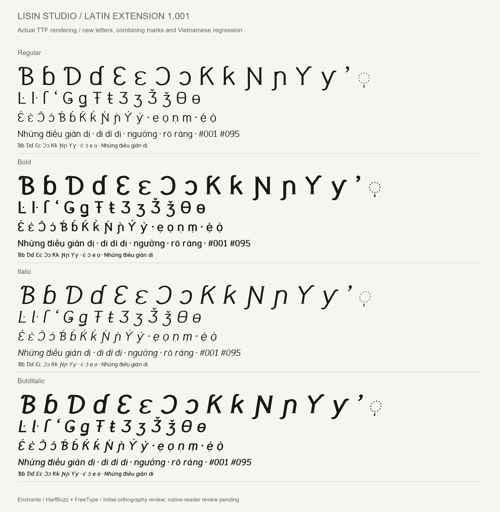
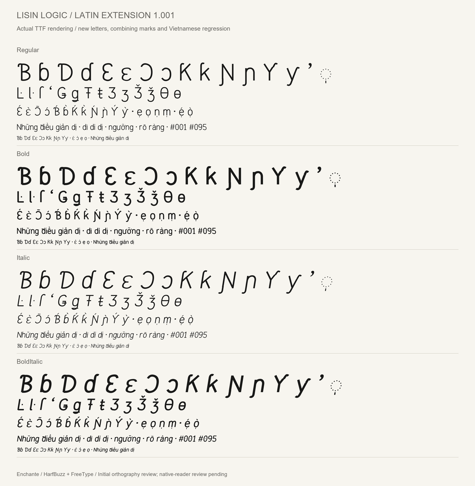
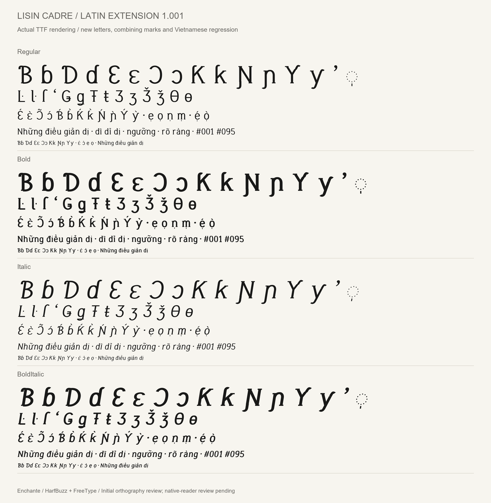

# Latin coverage extension — 1.001

All three Lisin families, each in Regular, Bold, Italic and Bold Italic,
add the following sixteen characters reported as missing in the 1.000
FontBakery language-shaping checks.

| Characters | Unicode | Function |
| --- | --- | --- |
| Ɓ ɓ | U+0181 / U+0253 | B with hook |
| Ɗ ɗ | U+018A / U+0257 | D with hook |
| Ɛ ɛ | U+0190 / U+025B | Open E |
| Ɔ ɔ | U+0186 / U+0254 | Open O |
| Ƙ ƙ | U+0198 / U+0199 | K with hook |
| Ɲ ɲ | U+019D / U+0272 | N with left hook |
| Ƴ ƴ | U+01B3 / U+01B4 | Y with hook |
| ʼ | U+02BC | Modifier letter apostrophe; a spacing letter |
| ◌̩ | U+0329 | Combining vertical line below; zero advance |

The fourteen auxiliary characters named in the same check's warnings are also
included: `Ŀ ŀ ſ ʻ Ǥ ǥ Ŧ ŧ Ʒ ʒ Ǯ ǯ Ɵ ɵ`. These cover middle-dot L, long S,
turned modifier comma, stroked G/T, Ezh (including caron) and barred O.

U+25CC DOTTED CIRCLE is also added as a carrier for showing standalone marks.
The project now maps 647 Unicode codepoints, up from 616. This count is not a
claim to support every Latin language or the complete Unicode repertoire.

The distinction between these letters and similar ordinary letters is
intentional. See the [Unicode Latin Extended-B chart](https://www.unicode.org/charts/PDF/U0180.pdf)
for character identities; its reference glyphs were not copied into this project.

## Engineering and review

- New base glyphs have above- and below-mark attachment positions.
- U+0329 has zero advance, a mark class and attachment to the existing bases.
- Regression checks compare every one of the 670 pre-existing glyph outlines
  and their metrics in each style with the 1.000 candidate.
- Existing 616 Unicode mappings and shaping samples remain unchanged.
- Every style retains the 429 existing NFC/NFD-equivalence checks and Latin Core
  coverage; Ezh with caron adds two more canonical equivalence pairs.
- Additional tests check that new tone-mark combinations do not add advance
  or collide vertically with their base outlines.
- Proofs below use the actual TTFs, shaped with HarfBuzz and rasterized with
  FreeType, at 64, 30, 22 and 14 pixels. They were visually inspected.

These are initial orthographic designs. Review by native readers and broad
application/print testing are still needed; automated coverage is not a
language-quality certification. See [QA status](QA.md) for remaining warnings.

## Actual-font specimens

